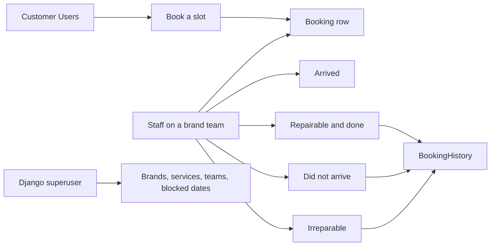

# AutoCare

**Workshop appointment API: customers book a service, staff move the car through arrival and repair, and Django admin owns brands, services and teams.**

The repository is the Django backend. Accounts, bookings and status changes are JSON. A Vite frontend is assumed on `http://localhost:5173` (`CORS_ALLOWED_ORIGINS`) and is not in this tree. `/` still renders an HTML landing page, but that page is the third-party Autofix template and its CSS and images are not included, so it is not a working client.

| | |
| --- | --- |
| Author | Djoud El Hak Belkhir · [djihad-elhak](https://github.com/djihad-elhak) |
| Stack | Django 5.0, Django REST framework, MySQL, Jazzmin |
| Project package | `gme` |
| App | `rv` |
| Customer UI origin | `http://localhost:5173` |

The README that is currently on `main` tells you to install `requirements.txt`, to copy an MIT `LICENSE`, and to load mail from `.env`. None of those files exist, and `settings.py` does not read the environment. This document follows the code.

---

## Contents

- [Roles](#roles)
- [Architecture](#architecture)
- [Repository layout](#repository-layout)
- [Data model](#data-model)
- [Authentication](#authentication)
- [API](#api)
- [Emails](#emails)
- [Capacity and dates](#capacity-and-dates)
- [Admin](#admin)
- [Run locally](#run-locally)
- [Security](#security)
- [Known gaps](#known-gaps)

---

## Roles



A customer account is a row in `rv.Users`, not Django's `auth_user`. A staff account is a row in the `staff` table. The administrator who opens `/admin/` is a normal Django superuser from `createsuperuser`. The three are not the same login.

---

## Architecture

| Piece | What it does |
| --- | --- |
| `rv.views` | JSON API and the `/` template |
| `rv.models` | Customers, staff, bookings, history, messages |
| `rv.signals` | Increments `Date.booking_count` when a booking is created, decrements it when one is deleted |
| `gme.settings` | MySQL, Gmail, CORS, Jazzmin |
| `gme.jazzmin` | The admin theme that actually applies (`settings.py` imports it over a smaller dict) |
| `rv/templates/*.html` | Status emails, plus unused dashboard and login templates |

`rv/celery.py` and `rv/tasks.py` are empty. Nothing is queued. `django-allauth` is installed and its middleware is on, and no allauth URL or provider is configured. `rest_framework_simplejwt` is named in `DEFAULT_AUTHENTICATION_CLASSES` and is not what login issues. Tokens are signed in the views with PyJWT.

`gme/urls.py` mounts `rv.urls` twice, at `/` and at `/api/`. Every route therefore exists twice. Paths below are the root mount. The same view is also at `/api` plus that path (`/api/api/client-booking/`, `/api/register/`, and so on).

---

## Repository layout

```text
.
├── manage.py
├── gme/                      # settings, urls, wsgi, asgi, jazzmin.py
├── rv/
│   ├── models.py
│   ├── views.py
│   ├── urls.py
│   ├── serializers.py
│   ├── admin.py
│   ├── signals.py
│   ├── authenticated.py      # DRF class, used only by change-password
│   ├── migrations/           # 0001 through 0008
│   └── templates/            # emails, index.html, unused staff pages
└── media/car_brand_logos/    # committed brand images
```

There is no `requirements.txt`, no `LICENSE`, no `.env`, and no `static/` directory. `STATICFILES_DIRS` points at `static/`, and Jazzmin's `site_logo` is `logo.png`. The logo files in the repo are `rv/logo.png` and `rv/logo.svg`, which that setting will not find.

`__pycache__` directories are committed, including bytecode for migration names that are no longer in `migrations/`. Those `.pyc` files are not the schema.

---

## Data model

| Model | Table role |
| --- | --- |
| `Users` | Customer. Subclasses `AbstractUser`. Email is unique. `USERNAME_FIELD` stays `username` |
| `Staff` | Workshop user. Also subclasses `AbstractUser`, stored in `staff`. Many-to-many to `Team` |
| `Team` | Subclasses `Group`, plus a `car_brand`. A staff member's bookings are that brand |
| `CarBrand` | Name and a logo under `media/car_brand_logos/` |
| `Service` | A job name, belonging to one brand |
| `Booking` | The live appointment. One brand, many services, plate, phone, names, description |
| `BookingHistory` | Snapshot written when staff closes a booking. The live row is then deleted |
| `Date` | One row per booked day, with `booking_count`. `is_full` is never written |
| `UnavailableDate` | Days an administrator has blocked by hand |
| `PasswordResetToken` | Six-digit token, one hour, tied to `Users` |
| `Message` | Public contact form: email, content, optional `reply_content` |
| `UserProfile` | One-to-one with `auth.User`, not with `Users`. No view uses it |

`Booking` and `BookingHistory` share the same status fields.

| Field | Values | Default |
| --- | --- | --- |
| `arrival_status` | `ARRIVED`, `NOT_ARRIVED`, `NOT_YET` | `NOT_YET` |
| `repair_status` | `REPAIRABLE`, `IRREPAIRABLE`, `NOT_YET` | `NOT_YET` |

`Team.car_brand`, `Booking.car_brand` and `Booking.user` default to primary key `1`. Creating rows before that brand and that customer exist will fail the foreign key.

Phone numbers are documented on the model as 10 digits (`Booking.clean`). The API serializer never calls `full_clean`, so the check does not run on `POST`.

---

## Authentication

Customers and staff both receive a JWT signed with the literal key `secret` and the `HS256` algorithm. That is not `settings.SECRET_KEY`. The token is returned as JSON `{"jwt": "<token>"}` and also stored in an HttpOnly cookie named `jwt`.

Every protected view reads the **header**, not the cookie:

```http
Authorization: <token>
```

There is no `Bearer ` prefix. A client that sends `Bearer <token>` will get `Invalid token`.

| | Customer | Staff |
| --- | --- | --- |
| Check | `check_password` (Django hash) | `password !=` the stored string, plain comparison |
| Lifetime | 600 minutes | `1000000000` minutes |
| Cookie | `httponly` | `httponly`, `secure`, `samesite=None` |

`POST /logout/` deletes the cookie and does not revoke the token. The header keeps working until `exp`.

`POST /change_password/` is the one view that uses `rv.authenticated.JWTAuthentication`. Same header, same key `secret`. Body is `old_password` and `new_password`. It calls `check_password`, so it matches customer hashes, not a staff password stored in clear text.

Password reset is customers only (`Users.email`).

1. `POST /password-reset-request/` with `email` stores a 6-digit token and tries to send it.
2. `POST /password-reset/` with `token`, `new_password`, `confirm_password`. The two passwords must match. The token must be unexpired. It is deleted on success.

The reset email uses `settings.DEFAULT_FROM_EMAIL`, which is not defined. Status emails use `EMAIL_HOST_USER`. Reset will not send until `DEFAULT_FROM_EMAIL` is set.

---

## API

Send JSON. Dates are `YYYY-MM-DD`. `services` is a list of service ids.

### Public

| Request | Body | Result |
| --- | --- | --- |
| `GET /` | — | Renders `index.html` |
| `GET /api/car-brands/` | — | `[{ "id", "name" }]`. Logos are not in this payload |
| `GET /api/services/<brand_id>/` | — | Services for that brand: `id`, `brand`, `name` |
| `GET /api/unavailable_dates/` | — | Manual blocks, plus any `Date` whose `booking_count` is 4 |
| `POST /api/message_form/` | `email`, `content`, optional `reply_content` | `201` and the saved message |

### Customer

| Request | Auth | Body | Result |
| --- | --- | --- | --- |
| `POST /register/` | no | `username`, `email`, `password` | `201` and `id`, `username`, `email`. No token |
| `POST /login/` | no | `username`, `password` | `{"jwt"}` and the cookie |
| `GET /user/` | header | — | The customer. `401` if the token is missing or expired |
| `POST /logout/` | no | — | Clears the cookie |
| `POST /change_password/` | header | `old_password`, `new_password` | `200` or `400` `Incorrect old password.` |
| `POST /password-reset-request/` | no | `email` | Sends the 6-digit token, or `404` if the email is unknown |
| `POST /password-reset/` | no | `token`, `new_password`, `confirm_password` | Sets the password |
| `POST /api/client-booking/` | header | See below | `201` and the booking |
| `GET /Bookinghistory/` | header | — | This customer's **live** bookings, not `BookingHistory` |

`POST /api/client-booking/` ignores any `user` or `email` in the body and writes the token's user id and email. The remaining fields are required by `BookingSerializer`:

| Field | Notes |
| --- | --- |
| `first_name`, `last_name` | max 50 |
| `phone_number` | max 15. The 10-digit model check is not applied |
| `car_plate_number` | max 20 |
| `car_model` | max 15 |
| `car_brand` | brand id |
| `services` | list of ids |
| `booking_date` | date |
| `description` | max 100 |

The view catches `User.DoesNotExist`. The lookup is `Users.objects.get`. A missing customer raises `Users.DoesNotExist`, which is not that handler, so a bad id becomes a 500 rather than the `404` the handler suggests.

`GET /Bookinghistory/` calls `Users.get_bookings()`, which is `Booking.objects.filter(user=...)`. Closed jobs live on `BookingHistory` and are not returned here. The `except Staff.DoesNotExist` branch in that view never runs.

### Staff

| Request | Body | Result |
| --- | --- | --- |
| `POST /api/staff/login/` | `username`, `password` | `{"jwt"}` |
| `GET /api/staff/data/` | — | `first_name`, `last_name`, `username`, `team` |
| `GET /api/staff-dashboard/` | — | Live bookings for the staff member's first team's brand |
| `GET /api/staff/history/` | — | `BookingHistory` rows whose `staff` is this user |
| `POST /api/bookings/<id>/car-arrived/` | — | Sets `arrival_status` to `ARRIVED` and emails. The booking stays |
| `POST /api/bookings/<id>/car-did-not-arrive/` | — | Emails, writes history with `NOT_ARRIVED`, deletes the booking |
| `POST /api/carfixed/<id>/` | — | Emails, writes history with `REPAIRABLE`, deletes the booking |
| `POST /api/booking/<id>/irreparable/` | — | Emails, writes history with `IRREPAIRABLE`, deletes the booking |

All of these except login expect the staff token in `Authorization`. The id inside the token is a `Staff` primary key. A customer token fails with `Staff not found`.

`GET /api/staff-dashboard/` is not a pure read. Before it responds it selects bookings of that brand with `arrival_status=NOT_YET` and `booking_date` more than 24 hours ago, emails each one "Car Did Not Arrive", copies them to history, and deletes them. The JSON for that request was built **before** the loop, so those bookings are still in the body. The next GET will not contain them.

History copies do not copy the `services` relation or `description`. `description` exists only on `Booking`.

`staff.get_bookings()` uses `self.team.first()`. A staff user with no team raises `AttributeError` on the dashboard.

Closing a booking does not check that the staff member's brand matches the booking's brand.

---

## Emails

SMTP is Gmail on port 587 with TLS, configured as literals in `settings.py`:

```text
EMAIL_HOST_USER = '#your email'
EMAIL_HOST_PASSWORD = '#create a email app password'
```

| Event | Template | Subject |
| --- | --- | --- |
| Mark arrived | `booking_arrived_email.html` | `you car arrived ` |
| Mark not arrived, or the 24-hour dashboard sweep | `booking_not_arrived_email.html` | `Car Did Not Arrive` |
| Mark fixed | `car_fixed_email.html` | `Your Car Is Fixed` |
| Mark irreparable | `car_irreparable_email.html` | `Car Is Irreparable` |
| Password reset | plain text | `Password Reset Request` |

Templates receive `first_name`, `last_name`, `car_brand` and `car_model`. The fixed email also receives `staff` as a full name. The dashboard sweep also passes `booking_id` and `booking_date`. `email.send(fail_silently=False)` means a bad SMTP setup turns the status call into a 500 and, for the close-out endpoints, can fail before the history row is written (`car_fixed_api` sends before it saves history).

---

## Capacity and dates

`GET /api/unavailable_dates/` is the calendar block list. It concatenates:

- every `UnavailableDate`
- every `Date` with `booking_count == 4`

Four is a constant in the view, not a setting. `Date.is_full` is unused. The signal maintains `booking_count` on create and delete, and removes the `Date` row when the count hits zero.

`POST /api/client-booking/` does not read that list. A fifth booking on a "full" day, or a booking on a manually blocked day, is still accepted. The cap is a hint for the client.

---

## Admin

`/admin/` is Jazzmin, titled Autocare (`gme/jazzmin.py`). Registered models: `CarBrand`, `Service`, `Booking`, `UnavailableDate`, `Team`, `Staff`, `Users`, `BookingHistory`, `Message`.

`MessageAdmin` shows email, content and `created_at`, and both add and change are disabled. `reply_content` cannot be edited there. Nothing else in the project writes a reply.

`createsuperuser` creates `auth.User`. It does not create a `Staff` or a `Users` row.

The Jazzmin file still contains the upstream sample: a "books" app, a Support link to the Jazzmin issue tracker, and `order_with_respect_to` entries that are not models in this project. The brand text and logo keys are the parts that apply.

---

## Run locally

MySQL, then a virtualenv. Packages are not pinned in the repo. The import graph needs:

```bash
python -m venv .venv
source .venv/bin/activate
pip install "Django==5.0.4" djangorestframework django-jazzmin django-allauth \
  django-cors-headers PyJWT mysqlclient Pillow djangorestframework-simplejwt
```

`mysqlclient` needs the MySQL client libraries. `Pillow` is what `ImageField` imports. `djangorestframework-simplejwt` is only there because `REST_FRAMEWORK` names it; login will not issue those tokens. If you remove that line from settings, you do not need the package.

In `gme/settings.py`, set `NAME`, `USER` and `PASSWORD`, and replace the two email placeholders. Add `DEFAULT_FROM_EMAIL` if reset mail should work. `ALLOWED_HOSTS` is empty, which is enough for localhost and wrong anywhere else. `DEBUG` is `True`.

```sql
CREATE DATABASE appointment_booking CHARACTER SET utf8mb4;
```

```bash
python manage.py migrate
python manage.py createsuperuser
python manage.py runserver
```

Then:

1. In `/admin/`, create at least one `CarBrand` (the default foreign keys expect id `1`), its `Service` rows, a `Team` for that brand, and a `Staff` user on that team.
2. `POST /register/` and `POST /login/` for a customer.
3. Point the Vite app at this origin and send the raw JWT on `Authorization`. CORS allows credentials from `http://localhost:5173` only.

`media/` is served only if you add the usual `static()` media route. `gme/urls.py` imports `static` and `settings` and does not use them, so brand logos are not served by these URLconfs.

---

## Security

Fix these before any host that is not your machine.

1. **Replace the JWT key.** Every token is signed with the string `secret`. Anyone who can see this repository can forge a customer or a staff token. Put a long random key in the environment and give the tokens a real lifetime. The staff lifetime is a billion minutes.
2. **Hash staff passwords.** `staff_login_api` compares the submitted password to the column with `!=`. Customers go through `set_password` / `check_password`. A staff user created in admin will not match this check unless the column happens to hold the clear password.
3. **Stop shipping `SECRET_KEY`.** The Django key in `settings.py` is a generated insecure default and it is public. Rotate it. Do not commit the replacement.
4. **`AllowAny` is the default permission.** A view that forgets the header check is public. Booking creation and staff actions do check. Car brands, services, unavailable dates and the contact form are public on purpose. `GET /` is public.
5. **The dashboard sweep sends mail as a side effect of a GET.** Anything that can call it with a staff token can email every overdue customer of that brand.
6. **Reset reveals whether an email is registered** (`404` versus `200`).
7. **`DEBUG = True` and `ALLOWED_HOSTS = []`.** Turn debug off and set hosts before a public deploy. Status-code handlers are inconsistent (`AuthenticationFailed` versus `Response(..., status=401)`), and debug pages will show the traceback.

---

## Known gaps

| Gap | What you will see |
| --- | --- |
| No `requirements.txt`, no `LICENSE`, no `.env` loader | The old README is ahead of the repo. This tree has no licence file; do not treat it as MIT until one is added |
| `rv.urls` included at `/` and `/api/` | Duplicate routes under an extra `/api` |
| Landing page | `index.html` is the Autofix template by codewithsadee. `static/` is missing, so the page has no stylesheet |
| `GET /Bookinghistory/` | Returns open `Booking` rows. The name does not match `BookingHistory` |
| History snapshot | `services` are not copied. `description` is not a history field |
| Full days | Count `4` only affects `GET /api/unavailable_dates/`. Create does not enforce it |
| `Date.is_full` | Never set |
| Staff with no team | Dashboard crashes |
| Brand scope | A staff token can close any booking id |
| `Message` replies | The field exists. Admin change permission is off, and no API writes a reply |
| `UserProfile`, allauth, Celery, SimpleJWT | Present or declared, not on the request path |
| `BookingFormView` missing-user handler | Catches `User.DoesNotExist` after querying `Users` |
| Media | Logos are stored as files. The URL conf never serves `MEDIA_URL` |
| Committed artifacts | `__pycache__` and multi-megabyte images under `media/car_brand_logos/` |

`tests.py` is the Django placeholder. There is no suite.
